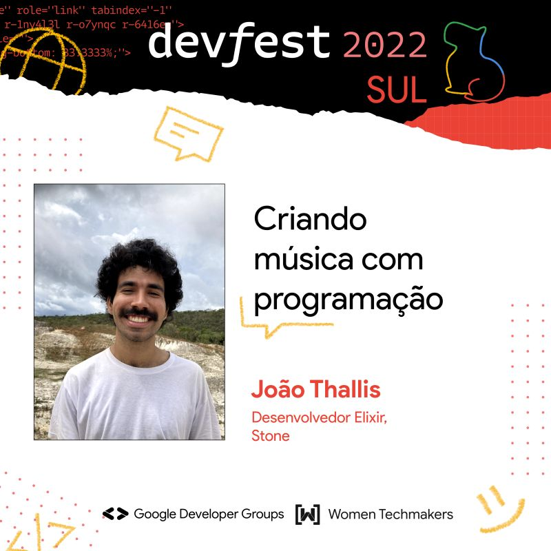

**DevFest Sul 2022**

December 10, 2022 — Florianópolis, Brazil

## About the workshop

In this workshop, participants learned the basics of Sonic Pi, a tool for creating music and live performance with code. By the end, they could create their own piece of music.

## About the speaker

João Thallis is a back-end software developer working with Python and Elixir. He has experience building resilient, distributed systems and using tools such as PostgreSQL, Docker, and Kubernetes. He is also interested in DevOps and automation.

[Original event post on LinkedIn](https://lnkd.in/p/dVx5tyiD)
