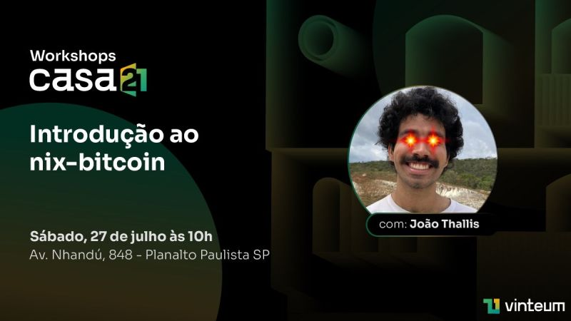

**Casa21 Workshops — Vinteum**

July 27, 2024, at 10:00

Casa21, São Paulo, Brazil

## About the workshop

nix-bitcoin is a collection of Nix packages and NixOS modules for installing full-featured Bitcoin nodes, with an emphasis on security. The workshop introduces Nix, the package manager and functional programming language, and NixOS, then covers using nix-bitcoin on a local machine, in virtual machines, and in the cloud. I also demonstrated installing NixOS on DigitalOcean using [nixos-infect](https://github.com/elitak/nixos-infect).

[Original event post on LinkedIn](https://lnkd.in/p/d3j9bYxG)
